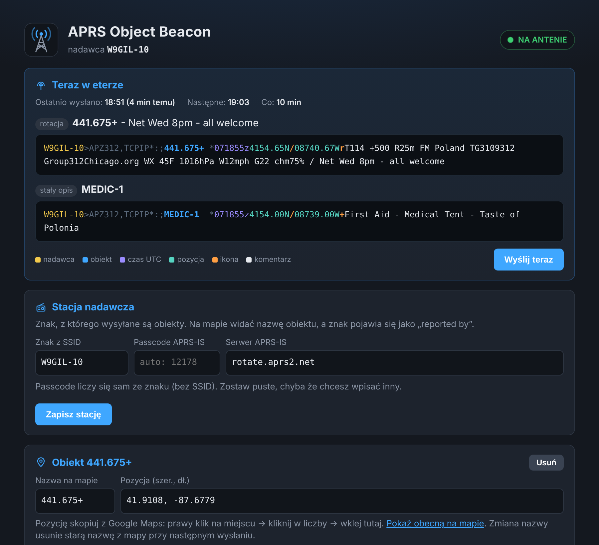

# APRS Object Beacon

**Put anything on the APRS map and keep its information fresh, automatically.**

APRS Object Beacon runs on a Raspberry Pi and sends **APRS objects** to the APRS-IS network every 10 minutes. An object can be a repeater, an emergency operations center, a first aid tent at a public event, a net control station or a shelter: any place people need to find. Each object carries a comment that can update itself with live weather, upcoming events, holiday greetings and rotating messages. Everything is managed from a simple web page on your local network.

One command installs it, on its own Pi or alongside an existing SvxLink / hotspot setup.

🇵🇱 [Wersja polska](README.pl.md)



---

## What is an APRS object, and why use one?

Normal APRS stations report **their own** position. An **object** is different. It is a map item with its own name, placed and kept alive **on behalf of something else** by any licensed station. It shows up on [aprs.fi](https://aprs.fi), in APRS apps and on the screens of APRS-capable radios, with a distance and bearing from the user.

That makes objects the right tool for places that matter but have no APRS of their own:

| Use | Example object | What people see |
|---|---|---|
| **Repeater** | `441.675+` | frequency, tone, offset, range, net times, local weather |
| **Emergency / EOC** | `EOC-COOK` | where the operations center is and how to check in |
| **Public service event** | `MEDIC-1`, `AID-2` | first aid tents and help points along a route or at a festival |
| **Incident command / net control** | `NCS-312` | where net control is set up today |
| **Shelter, club station, field day** | `SHELTER1`, `FD-2026` | location and a short note |

You can run several objects at once, each with its own icon and description. A club might keep its repeater on the map all year and add medical points only for the weekend of an event, then delete them with one click. Deleted or renamed objects are removed from the map automatically.

### Repeaters: the frequency-object convention

For repeaters, APRS has a well-established convention: name the object after its **frequency**, and start the comment with the tone, offset and range.

```
W9GIL-10>APZ312,TCPIP*:;441.675+ *071839z4154.65N/08740.67WrT114 +500 R25m FM Poland TG3109312 Group312Chicago.org
```

| Part | Meaning |
|---|---|
| `W9GIL-10` | the station that sends the object |
| `441.675+` | object name = repeater frequency and shift direction |
| `4154.65N/08740.67W` + `r` | position and the repeater icon |
| `T114` | CTCSS tone 114.8 Hz (`Toff` = no tone) |
| `+500` | offset +5 MHz, in 10 kHz steps |
| `R25m` | range 25 miles |
| `FM Poland …` | free-text description |

Formatted like this, a repeater object does more than show up on a map:

- **A driver passing through** sees `441.675+` on the radio's APRS list, with the distance to it. On many Kenwood and Yaesu APRS radios, one button tunes straight to it, tone included. The feature name differs by model.
- **aprs.fi** recognizes it as a repeater and shows frequency, tone and offset clearly.
- **Your club** gets a free notice board: the comment can announce a net, a meeting or a public service event to anyone who looks.

Repeaters rarely have APRS of their own, and sending objects by hand is easy to forget, so the information goes stale. This project automates it.

## Features

- **Multiple objects**, each with its own name, position, icon and description
- **Repeater mode** (optional per object): tone, offset and range in the standard APRS format
- **Icons** for repeaters, digipeaters, EOC, incident command, first aid, hospital, ambulance, fire, police, events, field operations, weather stations and more, or any custom APRS symbol
- **Automatic comment** (optional per object), chosen by priority:
  1. an event happening today: `Club meeting today 6pm`
  2. an upcoming event, counted down: `Club meeting in 3 days`
  3. a holiday, with fixed dates and calculated ones (Easter, Thanksgiving, Memorial Day, Labor Day, Pulaski Day, or any "Nth weekday of month")
  4. otherwise, a rotation of your own messages, one every 10 minutes
- **Live weather** from OpenWeather, anywhere in the text with `{wx}`
- **Web editor** at `http://<pi-address>/aprs/`, no password, reachable from your local network only
- **Live packet preview** with color-coded fields, last and next transmission time, and a "send now" button
- **APRS-IS passcode** calculated automatically from your callsign
- **Clean map**: deleting or renaming an object removes the old one (APRS object "kill")
- **Safe by default**: nothing is transmitted until you enter your own callsign and a position

## Install

On a Raspberry Pi running Raspberry Pi OS or Debian:

```bash
curl -fsSL https://raw.githubusercontent.com/woyteg/aprs-object-beacon/main/install.sh | sudo bash
```

The installer:

- detects your web server (Apache, lighttpd or nginx) and adds PHP to it. It installs Apache only if no web server is present, so an existing SvxLink or hotspot dashboard keeps working.
- installs the beacon in `/opt/aprs-beacon` and the editor in `/var/www/html/aprs/`
- enables a systemd timer that sends the objects every 10 minutes
- runs a test and prints the editor address

Then open **`http://<pi-address>/aprs/`** and fill in:

1. **Station:** your callsign with SSID, for example `W9GIL-10`. The passcode is filled in for you.
2. **Object:** name, position (paste it straight from Google Maps), icon and description. Tick **This is a repeater** to add tone, offset and range.
3. Need more? Click **+ Add object**.

That's it. The status badge turns green and your objects appear on aprs.fi within a few minutes.

## Update

Run the same install command again. The code is updated; your settings, objects, comments and API key are kept.

## Weather

Add live conditions to any object with the `{wx}` placeholder:

```
FM Poland TG3109312 Group312Chicago.org WX 45F 1016hPa W12mph G22 chm75% 0.05in
                                        └─ temperature, pressure, wind + gusts, cloud cover, rain/snow last hour
```

Weather is handy on a repeater ("what's it like up there?"), at an outdoor event, or at a field station.

How it works:

- Weather is fetched from the [OpenWeather](https://openweathermap.org) *Current Weather* API for the position of your **first object**. You can set a different location in `config.json`.
- It is refreshed **once an hour** by default (adjustable) and cached. The beacon reuses the cached data every 10 minutes, which keeps you well inside the free plan's limits.
- Gusts and precipitation appear only when they actually occur. Calm air shows as `calm`.
- Units are imperial (°F, mph, in) or metric (°C, m/s, mm).
- You can change the text template with `{temp} {press} {wind} {clouds} {precip} {hum} {desc}`.
- If OpenWeather is unreachable, the beacon uses the last data it has (up to 3 hours old). After that it simply drops the weather and sends the rest of the comment, so it never sends a broken or empty packet.

Put `{wx}` in an object's **fixed description** to include weather every time, or as a line in the **rotating messages** to include it now and then.

Setup:

1. Create a free account at openweathermap.org and copy your key from **My API keys**. New keys can take up to 2 hours to activate.
2. Paste the key into the **Weather** section of the editor. Only its last 4 characters are shown afterwards.

## Comment length

The APRS spec allows 43 characters in an object comment. APRS-IS and aprs.fi accept much longer ones, and many objects use them. This project defaults to 160 characters (`max_comment` in `config.json`). The editor shows how much room is left and flags anything that will be cut. Radios often display only the first part of a long comment, so put the most important information first.

## Files

```
/opt/aprs-beacon/beacon.py        the beacon
/opt/aprs-beacon/config.json      station, objects, weather settings
/opt/aprs-beacon/comments.json    rotating messages, holidays, events
/var/www/html/aprs/index.php      web editor
```

Useful commands:

```bash
sudo -u www-data python3 /opt/aprs-beacon/beacon.py --dry-run   # preview, nothing sent
journalctl -u aprs-beacon -n 20                                 # transmission log
systemctl list-timers aprs-beacon.timer                         # next run
```

## Uninstall

```bash
sudo bash /opt/aprs-beacon/src/uninstall.sh
```

A backup of your settings is saved to `/root/aprs-beacon-backup-*.tar.gz`. Your web server, PHP and Python are left in place.

## Notes

- The beacon sends over the internet to APRS-IS, not over RF. No radio or TNC is needed.
- Objects are sent under your callsign; you are responsible for keeping them accurate. Remove event objects when the event is over.
- The web editor has no password and is reachable from private (LAN) addresses only. Do not expose it to the internet.
- The editor interface is currently in Polish. An English version is planned.

## License

MIT. See [LICENSE](LICENSE).

---

Open source project by **W9GIL** · [Group 312 Chicago](https://group312chicago.org) · 73!
